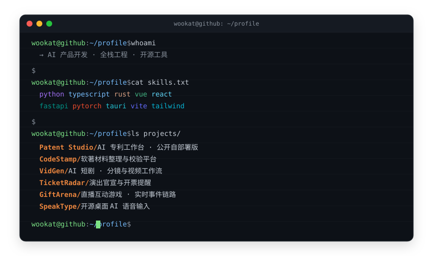

  

# wookat · AI 应用开发 / 全栈工程

从问题定义到可访问的产品：AI 工作流、前后端、跨端客户端、数据工程与开源开发者工具。以下是**代表成果**，包含开源工程和闭源在线服务；公开链接不意味着该项目所有代码均已开源。

[Zalize 中英文项目目录](https://zalize.com/zh/products/) · [English project catalog](https://zalize.com/products/)

## 核心产品平台

| 项目 | 做了什么 | 技术与边界 |
| --- | --- | --- |
| [知撰 · Patent Studio](https://patent.zalize.com) · [公开自部署版](https://github.com/wookat/patent-studio) | 专利技术材料、三书、附图与文档交付工作台 | React / TypeScript / FastAPI；公开版与线上服务分别维护 |
| [码印 · CodeStamp](https://sco.zalize.com) | 真实软件项目的软著材料整理、校验与导出 | FastAPI / React / 异步任务；源码不公开 |
| [开票雷达](https://piao.zalize.com) | 演出官宣、开票时间、巡演与提醒 | Next.js / Hono / Workers / D1；**信息服务，不是抢票程序** |
| [答岸](https://kaogong.zalize.com) · [源码](https://github.com/wookat/daan) | 考公刷题、错题和模考 | FastAPI / Vue 3 / uni-app，Web 与小程序工程 |
| [VidGen](https://video.zalize.com) | 文本、剧本、分镜、素材与视频生成的创作链路 | Next.js / FastAPI / 异步队列 / ComfyUI；源码不公开 |

## 求职、商业与跨端产品

- [速申](https://apply.zalize.com)：求职资料与网申表单辅助，提交仍由用户确认；浏览器插件 + Hono/Workers 后端。
- [Interview Copilot](https://interview.zalize.com)：桌面/浏览器采集端与移动 Web 协作的面试准备和练习工具；Electron、WebSocket 与 Durable Objects。
- [RezUp 简历工作台](https://cv.zalize.com)：简历编辑、内容组织与导出。
- [AStock](https://astock.zalize.com)：量化研究数据、因子与可视化；与模拟组合中的 [AI 操盘手](https://stock.zalize.com) 研究资产分开，不宣称实盘收益。
- [真题营](https://zhenti.zalize.com)：考研政治 Web 与微信小程序跨端刷题；小程序代码和生产 Web 后端分仓维护。
- [投顾助手](https://invest.zalize.com)：FastAPI + Expo/React Native 的移动/Web 投顾信息工程。
- [RiseWake](https://grow.zalize.com)：独立开发者产品分发、内容工程与获客归因；Workers / Hono / D1 / React。
- [SeatMark 座签](https://www.seatmark.cn)：考场名单、模板排版与批量打印；公开源码是 *source-available*，不是标准开源许可。
- [AI CDK 数字商品目录](https://aicdks.com)：商品同步、运营控制台与边缘店面；购买交付由上游完成。

## 国际化游戏、AI 与数据

- [GiftArena](https://giftarena.zalize.com)：基于 YouTube Live 官方事件流的互动游戏，Hono + Durable Objects + WebSocket 同步 OBS 画面与观众端。
- [ZALIZE Games](https://games.zalize.com)：多款网页小游戏与共享游戏平台；**Hook Rush** 包含 Web 与微信小游戏工程。
- [EmpathyDesk](https://empathydesk.zalize.com)：AI 客服工作台、发送前合规检查、风险处理、交接与质检；React / Hono / Workers / D1。
- [DataForge](https://data.zalize.com)：数据集定义、清洗、公开样本与目录；不公开私有原始数据。
- 竞赛工程：TAAC 2026 推荐模型训练/评估与 MathModel-OS 建模智能体，覆盖团队实验、任务编排与质量门控。

## 开源与开发者工具

| 项目 | 可复用的工程能力 | 源码许可 |
| --- | --- | --- |
| [SpeakType](https://speaktype.zalize.com) · [GitHub](https://github.com/wookat/speaktype) | Electron/React 桌面语音输入、本地 Whisper.cpp 与可配置云端识别 | MIT |
| [AgentGate](https://agentgate.zalize.com) · [GitHub](https://github.com/wookat/agentgate) | MCP 服务器扫描、锁定与门禁 | Apache-2.0 |
| [AgentMove](https://agentmove.zalize.com) · [GitHub](https://github.com/wookat/agentmove) | AI 客户端配置、MCP、技能与记忆迁移 | Apache-2.0 |
| [SkillWarden](https://skillwarden.zalize.com) · [GitHub](https://github.com/wookat/skillwarden) | Agent Skills 扫描、锁文件与 CI 漂移检查 | Apache-2.0 |
| [DomainHunter](https://github.com/wookat/domainhunter) | AI 命名、域名可注册性核验与 Worker/MCP 集成 | MIT |

更多公开项目见[仓库列表](https://github.com/wookat?tab=repositories)。我关注的是把 AI 能力接入真实业务流程，以及让前端、后端、数据与部署组成完整的产品链路。
